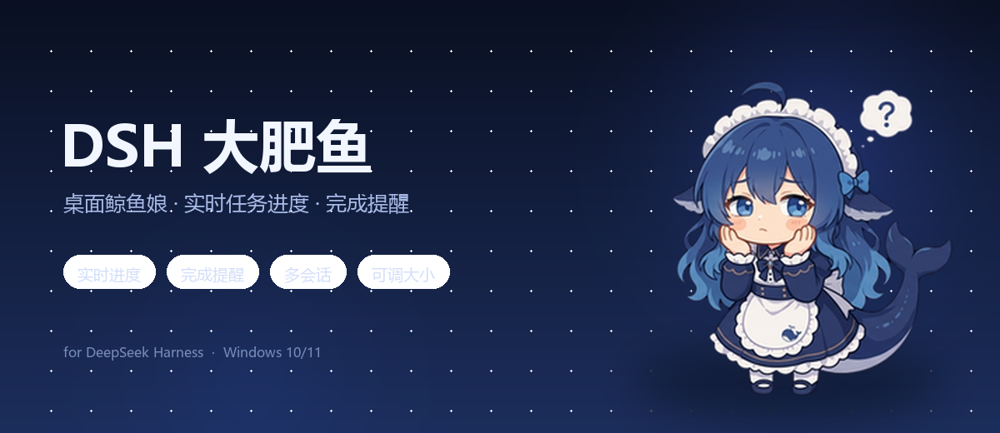
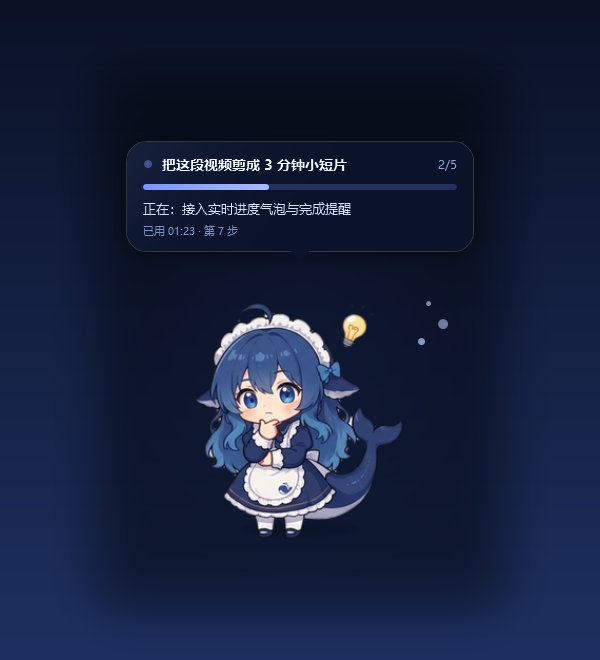
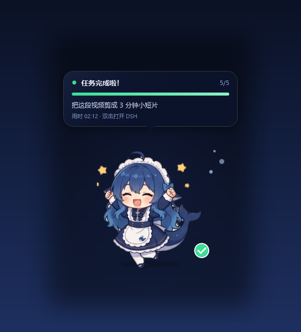

<div align="center">
  
  <h1>DSH 大肥鱼 · 桌面鲸鱼娘进度挂件</h1>
  <p>常驻桌面的 Q 版 DeepSeek「鲸鱼娘」，实时显示 DeepSeek Harness 的任务进度；任务完成时她会跳起来、放星光、响一声并弹 Windows 通知。</p>
  <p>
    
    
    
    
  </p>
</div>

> 非官方同人项目，与 DeepSeek 无隶属关系。「鲸鱼娘」是社区同人拟人形象。

## 功能

- **实时进度**：直接读取 DSH 会话日志（分帧 zstd + JSONL），显示任务标题、`todo_write` 进度、当前工具/步骤、已用时间、目标轮次。
- **状态动画**：思考、工作、待命、打瞌睡、出错、完成都有对应的 Q 版帧动画。
- **材质切换**：右键 → 材质 ▸ 深蓝色 / 白色磨砂 / 透明玻璃（20% 白）。
- **余额**：双击角色查询 DSH 当前模型所属 provider 的余额，显示约 3 秒后恢复任务进度；再次双击可刷新。provider/model 从会话日志读取，缺省回退到 profile 的 `agent-default-model`。支持 DeepSeek、OpenRouter、Moonshot/Kimi；其他 provider 会提示暂无余额接口。API Key 读取对应环境变量或 `~/.dsh/.credentials.yaml`。
- **完成提醒**：角色庆祝 + 星光 + 绿勾 + 提示音 + Windows 通知。
- **多会话**：右键菜单列出最近会话（`●` 运行中 / `○` 已结束），可固定显示某一个；默认跟随最近任务。
- **自定义大小**：70%–140%，角色、气泡、特效一起缩放，右下角锚定，记住选择。
- **互动**：拖动、悬停放大、单击展开详情、双击查看当前模型余额、摸摸头、托盘菜单、滚轮收起。
- **自动恢复**：后端心跳超时自动重启；不依赖 DSH API、端口或登录态，只读本机会话文件。
- **透明置顶**：按像素命中，透明区域鼠标穿透，不挡桌面操作。

<p align="center">
  
  
</p>

## 安装

### 环境要求

- Windows 10 / 11
- 已安装并启动过 **DSH Desktop**（挂件复用它的 Node 运行时和 desktop profile）
- PowerShell 5.1（系统自带）

### 方式一：克隆到 DSH 默认目录（推荐）

```bat
git clone https://github.com/<your-name>/dsh-fish-buddy.git "%USERPROFILE%\.dsh\fish-buddy"
cd /d "%USERPROFILE%\.dsh\fish-buddy"
install.cmd
```

`install.cmd` 会：

1. 停止正在运行的旧实例；
2. 备份并把插件条目写入 `%USERPROFILE%\.dsh\profiles\desktop\cordis.patch.yml`（绝对路径指向当前克隆目录）；
3. 拉起挂件。

然后**重启一次 DSH**，插件会在启动时自动拉起她。

### 方式二：克隆到任意目录

```bat
git clone https://github.com/<your-name>/dsh-fish-buddy.git D:\Tools\dsh-fish-buddy
cd /d D:\Tools\dsh-fish-buddy
install.cmd
```

安装脚本会把当前目录的绝对路径写进 profile，放在哪里都能用。

### 手动启动 / 停止

```bat
start-fish.cmd   :: 启动
stop-fish.cmd    :: 停止
```

### 关于 Node

挂件优先使用 DSH 自带的 `~/.dsh/dsh-runtimes/dsh-primary-runtime/dependencies/node/bin/node.exe`；找不到时回退到 `PATH` 里的 `node`。

## 使用

| 操作 | 效果 |
| --- | --- |
| 拖动角色 / 气泡 | 移动位置（会记住） |
| 悬停 | 轻轻放大 |
| 单击 | 展开 / 收起详情 |
| 双击 | 查看当前模型余额 |
| 右键 | 打开 DSH / 摸摸头 / 大小 − 100% + / 材质 / 会话选择 / 详情 / 提醒音 / 设置 / 重置位置 / 说明 / 退出 |
| 托盘图标 | 双击打开 DSH；右键摸摸头、自定义大小、放大/缩小、显示隐藏、重置位置、说明、提醒音、退出 |
| 滚轮 | 展开 / 收起详情 |

### 大小

右键菜单里有一行 **大小：− 100% +**：

- 点 `−` / `+` 每次 ±10%，范围 70%–140%。
- 点中间的数字弹出输入框，可以填任意 70–140 的比例（填 100 即恢复默认）。
- 菜单打开期间先缩放画面，关闭菜单后再移动/缩放窗口，避免菜单跟着跳走。
- 选择保存在 `ui.json`；托盘菜单也有「自定义大小… / 放大一点 / 缩小一点」。

### 设置

右键 → **设置** ▸：

- **开机自启**：写入/移除 `HKCU\Software\Microsoft\Windows\CurrentVersion\Run`，只影响当前用户，不需要管理员权限。
- **桌面通知**：任务完成时的 Windows 通知开关，保存在 `ui.json`。
- **总在最前**：挂件是否始终置顶，保存在 `ui.json`。
- **重启后端**：重启 `fish-core.mjs`，进度卡住或重连失败时用。
- **打开日志 / 安装目录 / 配置文件**：排查问题或改 `config.json` 时直接打开。
- **检查更新**：查询 GitHub 最新 Release，和当前版本比较。
- **关于**：版本、仓库地址、许可证。

### 材质

右键 → **材质 ▸**：

- **深蓝色**：最初的深色渐变气泡，浅色文字。
- **白色磨砂**：接近不透明的浅色玻璃，深色文字、灰色描边和白色尾巴；整块颜色统一，不再出现左右两半颜色不一致。
- **透明玻璃**：只加 20% 白，80% 背景直接透出；颜色会随背景变化（左右可能不同），文字用白色+投影。

选择保存在 `ui.json` 的 `material`。

### 多会话与自动恢复

- 右键菜单的 **会话：…** 列表会显示 `自动（最近任务）` 和最近 4 个会话；点一下固定显示，选「自动」恢复跟随。
- 后端每 600ms 写一次 `state.json` 作为心跳；超过 9 秒没更新时挂件显示「正在重新连接…」并自动重启后端。
- 后端崩溃会被自动拉起（最多 5 次），原因记录在 `logs/widget.log`。

## 角色状态

| DSH 状态 | 动作 |
| --- | --- |
| 思考 / 执行工具 | 托腮思考 + 小灯泡 |
| 待命 | 站立眨眼，久无任务后打瞌睡 |
| 任务完成 | 举手庆祝 + 星光 + 绿勾 + 提示音 + 通知 |
| 出错 | 惊讶表情 + 红色叹号 |
| 已停止 | 思考 / 待机 |

气泡里显示：任务标题、进度条 + `已完成/总数`、当前待办、已用时间与步骤数、目标轮次、多会话数量。

## 配置

首次运行会自动生成 `config.json`；也可以从示例复制：

```bat
copy config.example.json config.json
```

```json
{
  "mascot": "chibi",
  "scale": 1.0,
  "pollMs": 600,
  "completionWindowMinutes": 10,
  "activeWindowMinutes": 20,
  "dshUrl": "http://127.0.0.1:11821",
  "notify": true,
  "sound": true,
  "tray": true
}
```

| 字段 | 说明 |
| --- | --- |
| `mascot` | `chibi`（Q 版鲸鱼娘，默认）/ `whale`（全身立绘，需要自备 `assets/whale.png`）/ `fish`（矢量蓝色大肥鱼） |
| `scale` | 首次运行的默认大小，0.7–1.4；菜单里的选择会覆盖并记在 `ui.json` |
| `pollMs` | 后端扫描会话日志的间隔（毫秒） |
| `completionWindowMinutes` | 完成提醒的时间窗口（分钟） |
| `activeWindowMinutes` | 多久没有新事件就不再显示该会话（分钟） |
| `dshUrl` | 聚焦失败时兜底打开的地址（可选） |
| `notify` / `sound` / `tray` | Windows 通知 / 提示音 / 托盘图标 |

运行时生成、不入库的文件：`state.json`、`ui.json`、`logs/`、`*.pid`。

## 工作原理

```
DSH 会话日志 (~/.dsh/sessions/**/session.v4.jsonl.zstd)
        │  fish-core.mjs：分帧 zstd 解压 + 增量解析
        ▼
   state.json（标题 / turn / todo / tool / goal / 完成事件）
        │  fish-widget.ps1（WPF，400ms 轮询，状态帧动画）
        ▼
   桌面透明置顶窗（Q 版鲸鱼娘 + 气泡 + 托盘通知）
        ▲
        │  plugin/index.mjs（DSH 启动时拉起挂件）
```

- 只读本机会话日志，不联网、不依赖 DSH API / 端口 / 登录态。
- 透明区域鼠标穿透；窗口按内容自适应，不占用桌面操作。
- 插件只负责在 DSH 启动时叫醒挂件，重复启动会被单实例锁忽略。

## 项目结构

```
├─ install.cmd / install.ps1      写入 desktop profile 并启动
├─ uninstall.cmd / uninstall.ps1  停止并移除插件条目
├─ start-fish.cmd / stop-fish.cmd 手动启停
├─ config.example.json            配置示例
├─ bin/
│  ├─ fish-core.mjs               进度后端（Node，内置 zstd 分帧解析）
│  ├─ fish-widget.ps1             WPF 挂件 / 状态机 / 帧动画
│  ├─ chibi-ui.xaml               Q 版布局
│  ├─ whale-ui.xaml               全身立绘布局
│  ├─ fish-ui.xaml                矢量鱼布局
│  ├─ fish-widget.vbs             无控制台启动
│  └─ stop-fish.ps1               停止脚本
├─ plugin/index.mjs               DSH 启动插件
├─ assets/
│  ├─ whale/                      Q 版帧 + MIT LICENSE
│  ├─ screenshots/                README 预览图
│  ├─ chime.wav                   完成提示音
│  └─ fish.ico / fish.png         托盘图标
└─ THIRD_PARTY_NOTICES.md
```

## 常见问题

- **不更新进度**：查看 `logs/core.log` 是否有新的 `启动 fish-core`；或先 `stop-fish.cmd` 再 `start-fish.cmd`。
- **看不到她**：找任务栏托盘里的鱼图标；或重新运行 `start-fish.cmd`。
- **托盘图标在 `^` 溢出区里**：Windows 11 默认把新图标收进溢出区，图标本身是正常注册的。右键大肥鱼 → **把图标固定到任务栏…**，在打开的设置里进入 **个性化 → 任务栏 → 其他系统托盘图标**，找到带蓝色鲸鱼娘图标的 **Windows PowerShell**（挂件跑在 powershell.exe 下），把它打开即可常驻右下角。
- **插件没生效**：DSH 只在启动时读配置，装完/改完需要重启一次。
- **窗口位置跑偏**：右键 → 重置位置，或删除 `ui.json` 后重启。
- **想换全身立绘**：把图片放到 `assets/whale.png`（透明背景，竖图），把 `config.json` 的 `mascot` 改成 `whale` 后重启。该图片不随仓库分发。

## 卸载

```bat
uninstall.cmd
```

会停止挂件、备份并移除 `cordis.patch.yml` 里的插件段、清理开机自启；仓库目录保留，可自行删除。重启 DSH 后插件彻底消失。

## 致谢

- **Q 版鲸鱼娘帧**：来自 [vlln/whale-girl](https://github.com/vlln/whale-girl)，MIT License，Copyright (c) 2026 Sam Gao (vlln)。许可全文见 `assets/whale/LICENSE.txt`。
- 「鲸鱼娘」是社区同人形象，「DeepSeek」名称与商标归其所有者；本项目为非官方作品。

## 许可证

本项目代码以 [MIT License](LICENSE) 开源，可自由使用、修改和分发，保留版权与许可声明即可。

- 默认 Q 版鲸鱼娘素材同样为 MIT 授权，详见 [THIRD_PARTY_NOTICES.md](THIRD_PARTY_NOTICES.md)。
- 第三方素材的许可见各自说明。
